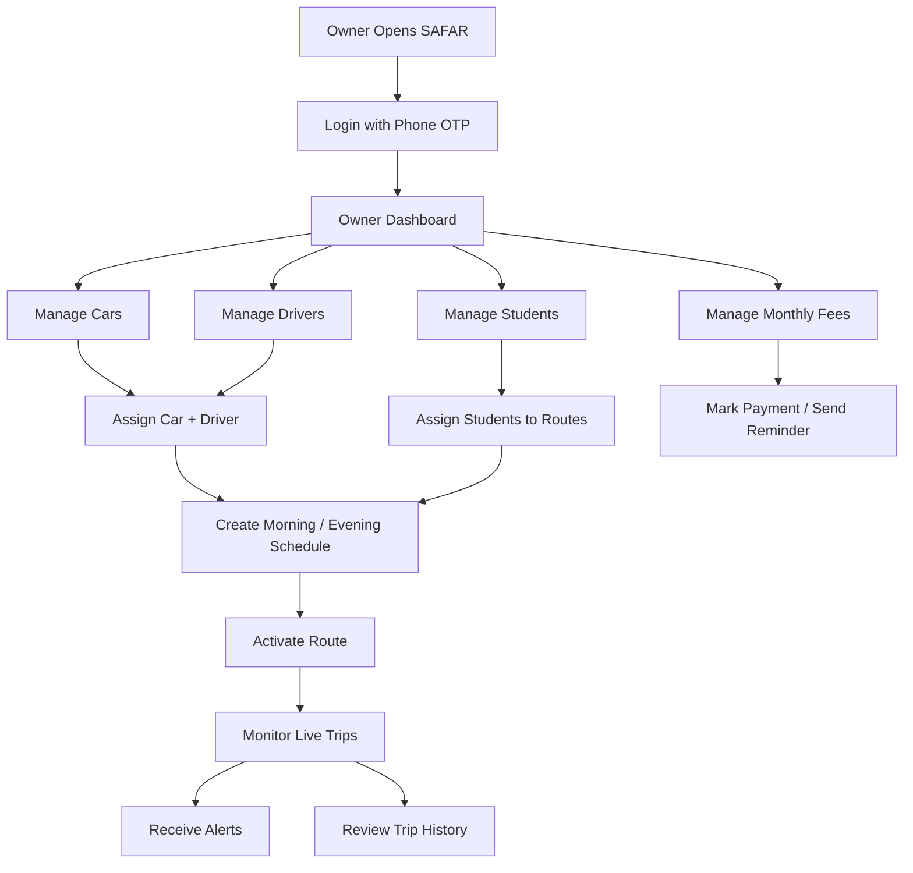
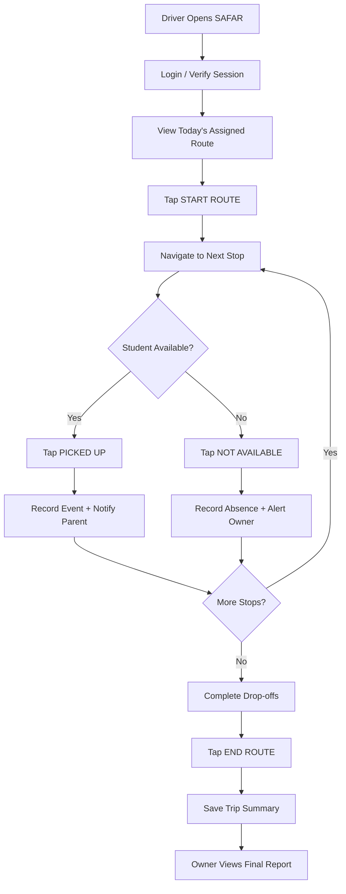

# SAFAR 
### Student Transportation Management System

**3 Interfaces + 1 Backend**

```text
┌─────────────────┐   ┌─────────────────┐   ┌─────────────────┐
│      OWNER      │   │     DRIVER      │   │     PARENT      │
│    (Web App)    │   │  (Mobile Web)   │   │   (WhatsApp)    │
└────────┬────────┘   └────────┬────────┘   └────────┬────────┘
         │                     │                     │
         └─────────────────────┼─────────────────────┘
                               │
                      ┌────────▼────────┐
                      │    BACKEND      │
                      │   + DATABASE    │
                      └─────────────────┘
```

---

## 1. OWNER WEB APP

### A. Login / Signup
- Phone number + OTP authentication
- Owner profile: name, city

### B. Dashboard (Home)
- Today's summary: cars running, students transported, pending pickups
- Live map showing all vehicles
- Alerts: delayed drivers, unconfirmed pickups

### C. Cars Management
- Add car: number plate, model, capacity
- Assign driver to car
- Status: active / inactive

### D. Drivers Management
- Add driver: name, phone, license photo upload
- Assign driver to a car
- View driver's daily log

### E. Students Management
- Add student: name, photo, class/college
- Pickup address and drop address
- Parent phone number
- Assign student to car/route
- Monthly fee amount + payment status

### F. Routes & Schedule
- Create routes with pickup points and times
- Assign route to car + driver
- Configure morning/evening schedules separately

### G. Live Tracking
- Map with moving vehicle markers
- Click a car to see driver name, students, and current stop
- Timeline: pickup and drop events with timestamps

### H. Fee Ledger
- Student | Month | Amount | Paid/Pending
- Mark payments as paid
- Send WhatsApp fee reminders to parents

### I. Alerts / History
- Pickup/drop logs with timestamps
- Missed pickups highlighted in red
- Driver delays and pending confirmations

---

## 2. DRIVER MOBILE WEB (Simple)

### A. Login
- Phone number + OTP
- Session-based login to avoid repeated authentication

### B. Today's Route Screen (Only Screen That Matters)

```text
┌────────────────────────────┐
│  CAR 3 — Morning Route     │
│  ─────────────────────     │
│  □ 7:30  Student A         │
│  □ 7:45  Student B         │
│  □ 8:00  Student C         │
│  ─────────────────────     │
│  [ 🟢 START ROUTE ]        │
└────────────────────────────┘
```

### C. When Route Starts → Each Stop Shows

```text
┌────────────────────────────┐
│  NEXT STOP: Student A      │
│                            │
│  📍 Green Park, Gate 2     │
│                            │
│  [ ✅ PICKED UP ]          │
│  [ ❌ NOT AVAILABLE ]      │
└────────────────────────────┘
```

- One tap records the pickup status
- Parent receives an automatic WhatsApp notification
- No typing. No map reading. No complexity.

### D. End Route Button

- Tap **Route Complete**
- Owner receives the trip summary

**That's it. 3 core actions: START ROUTE, PICKED UP / NOT AVAILABLE, END ROUTE.**

If the driver needs more than this, you've failed.

---

## 3. PARENT INTERFACE (WhatsApp)

### A. Automatic Notifications
- Child picked up
- Child dropped off
- Pickup missed or student unavailable, where applicable

### B. Fee Reminders
- Monthly fee due notification
- Pending payment reminder

### C. Example Notification

```text
SAFAR — Pickup Update

Your child has been picked up.
Time: 7:32 AM

Thank you for choosing SAFAR.
```

**No separate parent app required. Just timely updates through WhatsApp.**

---

## 4. BACKEND + DATABASE

### Core Responsibilities
- Authentication and role-based access
- Owner, driver, vehicle, and student management
- Route scheduling and assignments
- Pickup/drop event processing
- GPS location updates
- WhatsApp notification integration
- Monthly fee and payment records
- Alerts, trip history, and reporting

### Main Database Entities
- Owners
- Drivers
- Vehicles
- Students
- Parents
- Routes
- Route Stops
- Trips
- Pickup / Drop Events
- Fee Records
- Notifications

---

## 5. COMPLETE WORKFLOW

```text
OWNER CREATES ROUTE
        ↓
ASSIGNS DRIVER + VEHICLE
        ↓
ASSIGNS STUDENTS
        ↓
DRIVER STARTS ROUTE
        ↓
DRIVER RECORDS PICKUP / DROP
        ↓
BACKEND SAVES EVENT
        ↓
PARENT RECEIVES WHATSAPP UPDATE
        ↓
OWNER MONITORS LIVE STATUS
        ↓
ROUTE COMPLETED + SUMMARY GENERATED
```

---

## 6. CORE PRODUCT PRINCIPLE

| Interface | Primary Goal |
|---|---|
| Owner Web App | Complete control and visibility |
| Driver Mobile Web | Minimum interaction |
| Parent WhatsApp | Timely communication |
| Backend + Database | Centralized and reliable data |

**SAFAR = Simple for Drivers. Transparent for Parents. Powerful for Owners.**

---

## 3. PARENT SIDE (No App — WhatsApp Only)

### Messages You Send Automatically

| **Trigger** | **WhatsApp Message** |
|---|---|
| Student picked up | "✅ Aarav boarded Car 3 (KA-01-1234) at 7:42 AM. Driver: Ramesh (98xxxx)." |
| Student dropped at college | "🎓 Aarav reached [College Name] at 8:15 AM." |
| Driver late | "⚠️ Car 3 is running 10 min late today." |
| Fee due | "💰 Fee of ₹2,000 for October is pending. Pay to [owner UPI]." |
| Fee received | "✅ Payment received. Thank you." |

**No parent app to build.** Use WhatsApp Business Platform (Cloud API) or Twilio as an alternative notification provider.

---

## 4. BACKEND — What to Build

### A. Database Tables

```text
owners
  → id, name, phone, city

cars
  → id, owner_id, plate, model, capacity

drivers
  → id, owner_id, name, phone, license_url

students
  → id, owner_id, name, photo, class,
    pickup_addr, drop_addr, parent_phone, fee_amount

routes
  → id, owner_id, car_id, driver_id,
    type (morning/evening), name

route_stops
  → id, route_id, student_id, stop_order, pickup_time

trips
  → id, route_id, date, started_at, ended_at, status

trip_events
  → id, trip_id, student_id,
    event (picked/dropped/absent), timestamp

fees
  → id, student_id, month, amount, status, paid_at
```

### B. API Endpoints (REST)

#### Owner APIs

```http
POST   /auth/send-otp
POST   /auth/verify-otp

GET    /owner/dashboard

CRUD   /owner/cars
CRUD   /owner/drivers
CRUD   /owner/students
CRUD   /owner/routes

GET    /owner/live-tracking
GET    /owner/trips/history

GET    /owner/fees
POST   /owner/fees/:id/mark-paid
POST   /owner/fees/:id/send-reminder
```

#### Driver APIs

```http
GET    /driver/today-route

POST   /driver/trip/start
POST   /driver/trip/:id/event
       → event: picked / absent / dropped

POST   /driver/trip/:id/end

POST   /driver/location
       → GPS location ping every 30 seconds
```

#### Webhooks
## 5. TECH STACK (Recommended)

| **Layer** | **Choice** | **Why** |
| :--- | :--- | :--- |
| Frontend (Owner) | React + Tailwind CSS | Fast to build, good for dashboards |
| Frontend (Driver) | Same React app, mobile-optimized route | No separate codebase needed |
| Backend | Node.js + Express (or Python FastAPI) | Simple, fast |
| Database | PostgreSQL | Relational data fits perfectly |
| Maps | Google Maps JavaScript API + Directions API | Live tracking + route view |
| Auth | Phone OTP (MSG91 or Twilio) | No passwords = easier |
| WhatsApp | WhatsApp Business Platform (via Gupshup/Twilio) | Parent alerts |
| Hosting | Railway / Render / AWS Lightsail | Cheap start (~$10–20/mo) |
| GPS | Browser Geolocation API (driver's phone) | No hardware needed |

**Note:** This is the recommended stack, not a claim that every integration is already implemented. Hosting, maps, OTP, and WhatsApp costs depend on usage and provider pricing. Browser GPS requires location permission and an active browser session.

## 6. OWNER & DRIVER USER FLOWS

### A. OWNER FLOW (Web Application)

The owner manages the entire student transportation operation from one dashboard.



**Owner actions:**
1. Sign in using phone number and OTP.
2. Add vehicles and driver details.
3. Register students and parent contact information.
4. Create routes, pickup points, and schedules.
5. Assign students, drivers, and vehicles.
6. Monitor vehicle locations and pickup/drop status.
7. Receive alerts for delays and missed pickups.
8. Manage monthly fees and WhatsApp reminders.
9. Review completed trips and daily summaries.

### B. DRIVER FLOW (Mobile Web Application)

The driver uses a simple, mobile-friendly interface with minimal interaction while the vehicle is stationary.



**Driver actions:**
1. Log in and open the assigned route.
2. Review the ordered list of students and pickup times.
3. Tap **START ROUTE**.
4. At each stop, record pickup or unavailability.
5. Record drop-offs at the destination.
6. Allow the system to send configured parent notifications.
7. Tap **END ROUTE** after completing the trip.
8. The owner receives an updated trip summary.

### C. END-TO-END SYSTEM FLOW

```text
OWNER CREATES ROUTE
        ↓
DRIVER RECEIVES ASSIGNMENT
        ↓
DRIVER STARTS TRIP
        ↓
PICKUP / DROP EVENT RECORDED
        ↓
BACKEND UPDATES DATABASE
        ↓
PARENT RECEIVES WHATSAPP NOTIFICATION
        ↓
OWNER MONITORS TRIP STATUS
        ↓
TRIP COMPLETED
        ↓
DAILY SUMMARY GENERATED
```

### D. RESPONSIBILITY SUMMARY

| Action | Owner | Driver | Parent |
|---|---|---|---|
| Create routes | Yes | No | No |
| Assign students and vehicles | Yes | No | No |
| Start and operate assigned trip | Monitor | Yes | No |
| Record pickup/drop events | View | Yes | Receive updates |
| Receive trip notifications | Alerts and reports | Route status | WhatsApp |
| Manage fees | Yes | No | Receive reminders |
| Review trip history | Yes | Own trip status | Relevant notifications |

**Design principle:** The owner controls the operation, the driver executes the route, and the parent receives timely updates through WhatsApp.

*Implementation note: GPS tracking, notifications, and trip summaries must be connected to the backend to work automatically. Drivers should record events only when safely stopped.*
